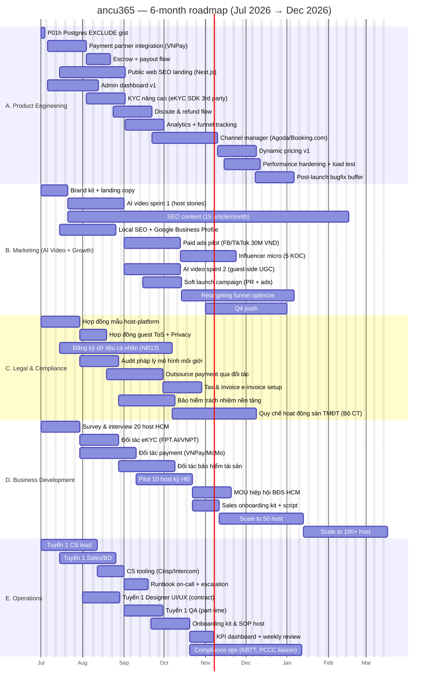

# ancu365 — 6-month Roadmap (07/2026 → 12/2026)

## 0. Tóm tắt điều hành

- **Đã build** (Phase 02-08 — commits tháng 6/2026): guest browse + lịch xem, host onboarding CCCD+bank, building/room/contract, hoá đơn batch + debt aging + meter, khai báo tạm trú HTML + Zalo deep-link, homestay calendar + pricing + reservation, marketplace ↔ ops sync 1 chiều.
- **Còn nợ kỹ thuật**: Phase 01h Postgres EXCLUDE gist (0.5d), payment gateway, public web SEO, admin dashboard, KYC nâng cao, dispute flow, analytics.
- **Chiến lược 6 tháng**: pilot 10 host HCM (Jul-Aug) → soft launch (Sep) → scale 100 listings (Oct-Nov) → 1000 booking + break-even unit economics (Dec).
- **Khuyến nghị phương án**: **B. Realistic** — ưu tiên critical path, defer 30% nice-to-have (xem §6).

---

## 1. Mermaid Gantt — 6 sections

> Render tested trên GitHub Mermaid v11. Dates inclusive, format `YYYY-MM-DD`.



---

## 2. Bảng phân công chi tiết

| # | Task | Owner | Start | End | Dependency | Acceptance Criteria | Risk |
|---|------|-------|-------|-----|------------|---------------------|------|
| **A — Product Engineering** | | | | | | | |
| A1 | Postgres EXCLUDE gist hardening | Dev1 | 07-01 | 07-03 | — | Reservation overlap chặn ở DB; pytest pass | L |
| A2 | Payment integration VNPay/MoMo SDK | Dev1 | 07-06 | 07-27 | A1, D3 | E2E: book → pay → callback → invoice paid | H |
| A3 | Escrow + payout T+1 cho host | Dev1 | 07-28 | 08-10 | A2, C5 | Payout job chạy hàng ngày, reconcile match 100% | H |
| A4 | Public web SEO landing (Next.js) | Dev2 | 07-15 | 08-18 | — | LCP <2.5s, sitemap 100 page, schema.org rentals | M |
| A5 | Admin dashboard v1 | Dev2 | 07-06 | 08-02 | A1 | Quản lý host/listing/dispute, role RBAC | M |
| A6 | KYC nâng cao eKYC SDK | Dev1 | 07-28 | 08-17 | A2, D2 | Auto match CCCD ↔ selfie, fraud score | H |
| A7 | Dispute & refund flow | Dev1 | 08-11 | 08-31 | A3 | Guest mở case, host respond, admin resolve, refund job | H |
| A8 | Analytics + funnel tracking | Dev2 | 08-19 | 09-08 | A4 | GA4 + Mixpanel, funnel guest signup → book → pay | M |
| A9 | Channel manager (Agoda/Booking) | Dev1 | 09-01 | 10-05 | A7 | Calendar sync 2 chiều, rate sync, 0 overbook | H |
| A10 | Dynamic pricing v1 | Dev1 | 10-06 | 10-26 | A9 | Suggested price theo occupancy + competitor | M |
| A11 | Performance hardening + load test | Dev1+Dev2 | 11-15 | 12-05 | A10 | 500 RPS API, p95 <500ms, 5k concurrent users | M |
| A12 | Post-launch bugfix buffer | All dev | 12-08 | 12-28 | A11 | Triage + ship critical fixes, no P0 open | M |
| **B — Marketing** | | | | | | | |
| B1 | Brand kit + landing copy | Designer + Marketing | 07-01 | 07-14 | E5 | Logo, color, fonts, voice guide, hero copy v1 | L |
| B2 | AI video sprint 1 — host stories | AI Video team | 07-15 | 08-13 | B1, D1 | 10 video host (TikTok/Reels), reach 100k organic | M |
| B3 | SEO content 15 article/month | Content writer | 07-15 | 12-11 | B1 | 90 article, 30 ranking top 10 Google "thuê nhà trọ HCM" | M |
| B4 | Local SEO + GBP listings | Marketing | 07-15 | 08-13 | B1 | GBP verified, 24 quận HCM tag, reviews seed | L |
| B5 | Paid ads pilot 30M VND | Marketing | 08-14 | 09-12 | B2 | CAC <150k VND/guest signup, CTR >2% | M |
| B6 | Influencer micro 5 KOC | Marketing | 09-13 | 10-12 | B5 | 5 KOC mỗi 50k-200k follow, CPM <50k | M |
| B7 | AI video sprint 2 — guest UGC | AI Video team | 08-14 | 09-12 | B2 | 12 video, UGC challenge hashtag #ancu365 | M |
| B8 | Soft launch campaign | Marketing + PR | 09-15 | 10-05 | A8, B6 | 3 PR articles, 50k unique visitors tuần launch | M |
| B9 | Retargeting funnel optimize | Marketing | 10-06 | 12-04 | B8 | ROAS >3, drop-off booking <40% | M |
| B10 | Q4 push — 1000-booking campaign | Marketing | 11-01 | 12-15 | B9, A10 | 1000 booking paid in Q4, CAC <120k | H |
| **C — Legal & Compliance** | | | | | | | |
| C1 | Hợp đồng mẫu host-platform | Chuyên gia + luật sư | 07-01 | 07-21 | — | Luật sư review xong, ký số ready | M |
| C2 | Hợp đồng guest ToS + Privacy | Chuyên gia + luật sư | 07-22 | 08-04 | C1 | Mounted on website, version 1.0 | L |
| C3 | Đăng ký dữ liệu cá nhân (NĐ13) | Chuyên gia | 07-15 | 09-12 | — | Hồ sơ nộp Bộ CA, biên nhận tiếp nhận | H |
| C4 | Audit pháp lý mô hình môi giới | Chuyên gia + luật sư | 07-22 | 08-11 | C1 | Risk memo, GO/NO-GO cho hold escrow | H |
| C5 | Outsource payment qua đối tác có GP NHNN | BD + Chuyên gia | 08-05 | 09-03 | C2, D3 | Hợp đồng đối tác ký, không cần GP TGTT riêng | H |
| C6 | Tax & e-invoice setup | Chuyên gia + Finance | 09-04 | 09-24 | C5 | Phát hành hoá đơn điện tử từng giao dịch | M |
| C7 | Bảo hiểm trách nhiệm nền tảng | Chuyên gia + BD | 08-12 | 09-10 | C4 | Policy 500M VND limit cho mỗi vụ tranh chấp | M |
| C8 | Quy chế sàn TMĐT (Bộ Công Thương) | Chuyên gia | 09-13 | 10-27 | C3 | Đăng ký online.gov.vn, có biên nhận | H |
| **D — Business Development** | | | | | | | |
| D1 | Survey & interview 20 host HCM | BD + PM | 07-01 | 07-21 | — | Insight report, 20 NPS feedback, 5 user persona | L |
| D2 | Đối tác eKYC (FPT.AI/VNPT) | BD | 07-22 | 08-11 | D1 | HĐ ký, sandbox test pass, pricing locked | M |
| D3 | Đối tác payment (VNPay/MoMo) | BD | 07-22 | 08-20 | D1 | HĐ ký, merchant ID active, fee <2% | H |
| D4 | Đối tác bảo hiểm tài sản | BD | 08-12 | 09-10 | D2 | MOU, sản phẩm bảo hiểm host opt-in | M |
| D5 | Pilot 10 host ký HĐ | BD + Sales | 08-21 | 09-19 | D3, C1 | 10 HĐ ký, 30+ listing live | H |
| D6 | MOU hiệp hội BĐS HCM | BD + Chuyên gia | 09-20 | 10-10 | D5 | MOU ký, channel intro 50 host | M |
| D7 | Sales onboarding kit + script | Sales lead | 09-20 | 10-03 | D5 | Deck, demo script, pricing 1-pager | L |
| D8 | Scale to 50 host | Sales | 10-04 | 11-17 | D7 | 50 host active, 150 listing live | M |
| D9 | Scale to 100+ host | Sales | 11-18 | 12-31 | D8 | 100 host active, 300 listing live | M |
| **E — Operations** | | | | | | | |
| E1 | Tuyển 1 CS lead | Founder | 07-01 | 07-30 | — | Offer ký, start 08-01 | M |
| E2 | Tuyển 1 Sales/BD | Founder | 07-15 | 08-13 | — | Offer ký, start 08-15 | M |
| E3 | CS tooling Crisp/Intercom | CS lead | 07-31 | 08-13 | E1 | Live chat <2min response, ticket SLA def | L |
| E4 | Runbook on-call + escalation | CS lead + Dev | 08-14 | 08-27 | E3 | P0/P1/P2 def, on-call rotation, paging Telegram | M |
| E5 | Tuyển 1 Designer UI/UX (contract) | Founder | 08-01 | 08-21 | — | 3 month contract, weekly Figma deliverable | L |
| E6 | Tuyển 1 QA (part-time) | Founder | 09-01 | 09-21 | — | Smoke test guide, regression sheet | L |
| E7 | Onboarding kit & SOP host | CS lead | 08-28 | 09-17 | E4, D5 | 1-pager checklist, video walkthrough 5 phút | L |
| E8 | KPI dashboard + weekly review | Founder + Ops | 09-18 | 10-01 | E7, A8 | Metabase dash, weekly Mon 9am review | L |
| E9 | Compliance ops (KBTT, PCCC liaison) | Ops + Chuyên gia | 09-18 | 11-16 | E7, C3 | Quy trình tiếp công an quận, log 100% case | M |

**Total: 47 tasks across 5 sections.**

---

## 3. Milestones quan trọng

| ID | Milestone | Target date | Trigger / Done criteria |
|----|-----------|-------------|--------------------------|
| **M1** | Payment gateway live | 2026-08-10 | A3 done, VNPay/MoMo callback verified end-to-end |
| **M2** | 10 host pilot ký HĐ | 2026-09-19 | D5 done, 30 listing trên marketplace |
| **M3** | Soft launch HCM | 2026-10-05 | M2 + A7 + B8 + C5 done, public traffic enabled |
| **M4** | 100+ listings active | 2026-11-17 | D8 done, listings indexed bởi GBP + sitemap |
| **M5** | First 1000 booking paid | 2026-12-15 | B10 done, ≥1000 invoice status=paid Q4 |
| **M6** | Unit economics break-even path | 2026-12-31 | CAC <120k, AOV >1.5M, gross margin >18% trên 3 tháng liền |
| **M7** | Compliance pack hoàn tất | 2026-11-15 | C1+C2+C3+C5+C7+C8 done, ready audit ngoài |

---

## 4. Phân tích phụ thuộc

### Critical path

```
D1 (Survey) → D3 (Payment partner) → A2 (Payment SDK) → A3 (Escrow)
            ↘                                       ↘
              C5 (Outsource payment legal)            A7 (Dispute)
                                                   ↘
                                              M3 (Soft launch 10-05)
                                                   ↘
                                              D7→D8→D9 (Scale host)
                                                   ↘
                                              B10 (Q4 push) → M5 (1000 booking)
```

**Critical path length:** ~14 weeks Jul-01 → Oct-05 (M3 soft launch). Trễ payment partner (D3) hoặc legal payment outsource (C5) là risk lớn nhất → toàn bộ launch trượt.

### Risk lớn nhất nếu trễ

| Risk | Tác động | Mitigation |
|------|----------|------------|
| **Payment partner (D3) trễ** | Trượt M1 → trượt M3 → mất Q4 doanh thu | Khởi động đối tác Tuần 1, dùng 2 đối tác song song (VNPay + MoMo), fallback bank-transfer + manual reconcile |
| **NĐ13 đăng ký (C3) chậm** | Risk pháp lý lưu dữ liệu CCCD | Bắt đầu tuần 3, chuẩn bị Privacy Policy version sandbox cho soft launch |
| **Pilot 10 host (D5) <10** | Trượt M2, không đủ supply cho launch | Buffer 15 host trong pipeline, ưu đãi miễn phí 3 tháng đầu |
| **Channel manager (A9) trượt** | Mất khả năng cạnh tranh OTA, giảm occupancy | Defer sang Q1/2027, ship dynamic pricing thuần trước |
| **Tuyển CS/Sales chậm** | Founder gánh CS → đốt thời gian dev | Bắt đầu tuyển ngày 01-07, fallback freelancer CS |

### Buffer khuyến nghị

- **Engineering**: 15% buffer (A12 = 3 tuần 12/08-12/28) cho post-launch bugfix.
- **Legal**: 30% buffer (luật sư VN thường chậm 2-4 tuần) — đã reflect trong C1=21d, C3=60d, C8=45d.
- **BD**: 20% buffer trong D5 (pilot có thể slip 1-2 tuần khi host so sánh điều khoản).
- **Tết âm 2027**: tuần 1 tháng 1 2027 → tuần 1 tháng 2 2027. Tránh launch lớn cuối tháng 12, freeze code change từ 2026-12-20.

---

## 5. Capacity assessment

### Dev team (1-2 dev + AI assistant, ~40 SP/sprint 2 tuần)

Tổng effort engineering trong section A: ~232 dev-days = 46 dev-weeks. Trong 26 tuần (6 tháng), với 2 dev → 52 dev-weeks capacity. **Khả thi NẾU**: A9 (channel manager) defer, A10 (dynamic pricing) thu hẹp v1. Nếu chỉ 1 dev fulltime → **không khả thi**, phải cắt A6 (KYC) + A9 + A10.

| Tuần | Workload (dev-days) | Capacity 2 dev (10d/wk) | Status |
|------|---------------------|-------------------------|--------|
| Jul (4 tuần) | 38 (A1+A2+A4+A5) | 80 | OK 48% |
| Aug (4 tuần) | 56 (A3+A4+A5+A6+A7+A8) | 80 | OK 70% |
| Sep (4 tuần) | 40 (A7+A8+A9) | 80 | OK 50% — buffer cho soft launch |
| Oct (4 tuần) | 56 (A9+A10) | 80 | OK 70% |
| Nov (4 tuần) | 48 (A11+A10) | 80 | OK 60% |
| Dec (4 tuần) | 36 (A11+A12) | 80 | OK 45% — Tết freeze |

**Verdict**: Khả thi với 2 dev fulltime + AI assistant. Nếu chỉ 1 dev → áp dụng phương án C (Conservative).

### Cần tuyển thêm

| Role | Khi nào | Lý do |
|------|---------|-------|
| **CS Lead** | Tuần 1 tháng 7 | Trước M2 (host pilot) cần CS handle ticket host onboarding |
| **Sales/BD** | Tuần 3 tháng 7 | D5 pilot cần người outbound 20-30 host/tuần |
| **Designer UI/UX (contract)** | Tháng 8 | A4 SEO landing + onboarding screens cần design quality |
| **QA part-time** | Tháng 9 | Trước soft launch M3, regression manual cần người không phải dev |
| **Content writer freelance** | Tuần 2 tháng 7 | B3 cần 15 article/tháng, founder không scale |
| **2nd Dev fulltime (nếu chỉ 1)** | Tháng 7 | Critical: capacity buộc 2 dev mới fit timeline B |

### AI Video team — đủ 8-12 video/tháng?

- **Nhu cầu**: B2 (10 video tháng 7-8), B7 (12 video tháng 8-9), B10 push (cần ~15 video tháng 11-12). Tổng ~60 video trong 6 tháng = ~10 video/tháng. **Vừa đủ capacity 8-12/tháng**.
- **Risk**: Q4 push cần burst 15/tháng → cần bookahead hoặc tăng đối tác AI.
- **Đề xuất**: Lock content calendar 4 tuần trước. Reserve 20% capacity cho reactive content (trend hijack).

---

## 6. Đề xuất 3 phương án scope

### Phương án A — Aggressive (tất cả 47 task trong 6 tháng)

- **Pros**: ship đủ payment + channel manager + dynamic pricing + Q4 push → vị thế cạnh tranh top.
- **Cons**: 2 dev burn 70-80% liên tục, không buffer khi đối tác (payment/legal) chậm. Khả năng trượt M3 ~50%.
- **Risk**: Cao. Cần ≥3 dev hoặc giảm scope khi vào tháng 9.

### Phương án B — Realistic (RECOMMENDED) — defer 30% nice-to-have

**Defer sang Q1/2027:**
- A9 Channel manager (Agoda/Booking sync) — chờ sau 1000 booking để có leverage thương lượng.
- A10 Dynamic pricing v1 → ship v0 (suggested price tĩnh theo weekend/holiday) trong A5 admin dashboard.
- B10 Q4 push downsize: target 500 booking thay vì 1000 (M5 → revised).
- D9 Scale 100+ host → target 80 host EOY.

**Pros**: Critical path bảo toàn (M1, M2, M3), buffer tăng 30%, capacity 2 dev hợp lý.
**Cons**: Mất ~30% upside revenue Q4, nhưng giữ chất lượng launch.

### Phương án C — Conservative (chỉ MVP launch, defer SaaS subscription sang Q1/2027)

- **Defer**: A6 KYC nâng cao, A9 channel manager, A10 dynamic pricing, B6 influencer, D6 MOU hiệp hội.
- **Focus**: M1 (payment) + M2 (10 host) + M3 (soft launch) + duy trì stable 50 host EOY.
- **Pros**: Khả thi với 1 dev. Buffer 40%. Tết safe.
- **Cons**: Mất 50% revenue upside Q4. Không monetize SaaS subscription mode đến Q1/2027.

### Khuyến nghị: **Phương án B**

Lý do:
1. Phase 02-08 đã build core ops vững → engineering chỉ cần ship payment + admin + launch polish.
2. Pilot 10 host (M2) là gate quan trọng nhất → bảo toàn timeline pilot.
3. Defer channel manager + dynamic pricing v1 không gây mất khách trong Q4 vì supply còn nhỏ.
4. Buffer 30% legal đủ hấp thụ slip của NĐ13/payment partner.
5. Q4 500 booking realistic hơn 1000 với supply 80 host.

---

## 7. Câu hỏi mở

1. **Vốn hoạt động**: Ngân sách 6 tháng (lương dev + AI video team + paid ads 30M+ + legal fees + tooling)? Cần locked trước khi commit lương CS/Sales.
2. **Founder bandwidth**: Founder tham gia BD/sales pilot 10 host trực tiếp, hay full delegate cho Sales hire?
3. **Đối tác payment ưu tiên**: VNPay vs MoMo vs Stripe (qua đối tác có GP NHNN)? Quyết định ảnh hưởng C5 + A2.
4. **Phạm vi địa lý**: Chỉ HCM 6 tháng, hay mở Hà Nội từ tháng 11? Mở rộng địa lý đốt CS + sales nhân đôi.
5. **SaaS subscription model**: Có thu phí host (vd 99k/tháng/listing) ngay M3, hay miễn phí 3 tháng pilot rồi mới charge? Ảnh hưởng D5 đàm phán.
6. **Mobile app store**: Có submit iOS/Android app store trong 6 tháng (App Review 1-2 tuần), hay PWA web-first?
7. **Tết freeze policy**: Code freeze 12-20 → khi nào unfreeze? Tuần 2 tháng 2 2027?
8. **Insurance limit**: Bảo hiểm 500M VND/case có đủ cho dispute scale lớn (vd host damage 1 tỷ)? Cần upsize?
9. **CS SLA target**: First-response <2min thực sự khả thi với 1 CS lead? Hay nên set <30min với chatbot fallback?
10. **AI video budget**: Có sẵn hợp đồng với AI Video team chưa, hay cần ký mới? Pricing per video lock được không?

