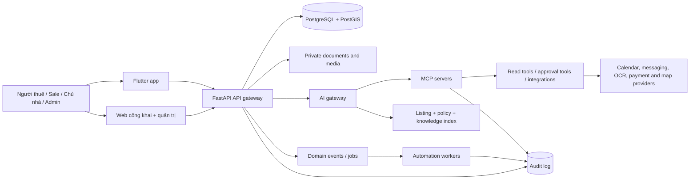

# 00 — Tổng quan Ancu365 Japan

## Tầm nhìn sản phẩm

Ancu365 Japan là nền tảng hợp nhất hành trình từ **tìm căn phù hợp → hỏi thông tin → xem nhà → nộp hồ sơ → ký hợp đồng → thanh toán → ở và yêu cầu hỗ trợ**. Hệ thống phục vụ thị trường Nhật bằng trải nghiệm tiếng Nhật mặc định, dữ liệu bất động sản theo cách người Nhật tìm nhà và trợ lý AI có thể đọc dữ liệu thật của hệ thống.

Sản phẩm có ba bề mặt chính:

| Bề mặt | Vai trò |
|---|---|
| **Web công khai** | SEO listing, tìm kiếm theo ga/tuyến, trang chi tiết, bài hướng dẫn thuê nhà và nhận lead |
| **App** | Tìm nhà, yêu thích, hỏi đáp, lịch xem, hồ sơ thuê, hợp đồng, hóa đơn, hỗ trợ; workspace riêng cho từng role |
| **Web vận hành/quản trị** | Quản lý listing, người dùng, hồ sơ, đối tác, tài chính, nhiệm vụ, SLA, audit và AI copilot |

Backend hiện tại đã có nền tảng phù hợp để tái sử dụng: FastAPI, PostgreSQL/PostGIS, JWT, REST/WebSocket, listing, viewing appointment, rental journey, contract, tenant, invoice, sale CRM, owner workspace và admin backoffice. Nhật hóa nên đi theo các API additive và feature flag để giữ luồng đang chạy.

## Định vị tại Nhật

Sản phẩm tập trung vào ba nhu cầu có giá trị rõ:

1. Người thuê, bao gồm người nước ngoài, tìm được căn phù hợp theo ga, tuyến, thời gian đi bộ, tổng chi phí ban đầu và điều kiện thuê.
2. Chủ nhà và công ty môi giới xử lý lead, lịch xem, hồ sơ, tài liệu và theo dõi giao dịch trong cùng một workspace.
3. Đội quản trị giảm việc nhập liệu lặp lại bằng AI và automation nhưng mọi quyết định có tác động đến quyền lợi, tiền hoặc hợp đồng vẫn có người chịu trách nhiệm.

## Mô hình vai trò

Một tài khoản có thể được cấp đồng thời ba workspace nghiệp vụ:

| Role trong sản phẩm | Tên tiếng Nhật | Mục tiêu |
|---|---|---|
| Khách/tenant | 入居者・借主 | Tìm, hỏi, xem, nộp hồ sơ, theo dõi thuê và yêu cầu hỗ trợ |
| Sale/môi giới | 仲介担当者・営業担当 | Quản lý lead, nguồn hàng, lịch xem, follow-up, hồ sơ và pipeline |
| Chủ nhà | オーナー・貸主 | Quản lý tòa/phòng, người thuê, hợp đồng, tiền, bảo trì và báo cáo |
| Quản trị | 管理者・運営スタッフ | Quản lý nền tảng, policy, nội dung, phê duyệt, audit và phân quyền |

Đăng nhập phải cho người dùng chọn workspace muốn vào. Quyền thực tế được lấy từ server capability, không suy ra chỉ từ nhãn hiển thị trên client.

## Nguyên tắc sản phẩm

- **Japan-first:** tiếng Nhật, JPY, địa chỉ Nhật, ga/tuyến và thuật ngữ thuê nhà là mặc định; tiếng Việt/English là lớp hỗ trợ.
- **Chi phí minh bạch:** luôn tách tiền thuê, 管理費/共益費, 敷金, 礼金, 仲介手数料, 保証会社料, bảo hiểm và tổng chi phí ban đầu.
- **AI có nguồn:** câu trả lời phải trỏ về listing, tài liệu hoặc policy đã dùng; dữ liệu giá và trạng thái phòng phải có thời điểm cập nhật.
- **Tác động có người duyệt:** AI được đọc, phân loại, soạn thảo và đề xuất; việc gửi hồ sơ, sửa hợp đồng, thu tiền, từ chối người thuê hoặc thay đổi quyền phải có approval.
- **Riêng tư theo workspace:** chủ nhà chỉ thấy tài sản của mình; sale chỉ thấy lead/assignment được cấp; tenant chỉ thấy hồ sơ của mình; admin có quyền theo scope và mọi truy cập nhạy cảm đều audit.
- **Tương thích dần:** giữ API và luồng hiện tại, bổ sung locale, currency, Japan domain fields, AI gateway và MCP theo từng phase.

## Kiến trúc cấp cao

## Trạng thái hiện tại và mục tiêu

| Năng lực | Hiện trạng repo | Mục tiêu Nhật hóa |
|---|---|---|
| Auth và role | Có JWT, customer/sale/owner/admin workspace | Locale Nhật, role picker, capability và policy theo organization |
| Listing | Có nhà/phòng, tiện ích, giá, diện tích, loại giao dịch | Thêm ga, tuyến, phút đi bộ, JPY, 敷金/礼金, 外国人可, ペット可, 初期費用 |
| Lịch xem | Có viewing appointment và trạng thái | Tự động đề xuất slot, nhắc lịch bằng tiếng Nhật, no-show và reschedule |
| Rental journey | Có flow khách–sale–chủ nhà, hợp đồng, invoice | Hồ sơ thuê Nhật, IT重説 readiness, tài liệu đa ngôn ngữ và audit |
| Admin | Có backoffice và approval | Japan operations console, policy version, AI queue, MCP approval queue |
| AI/MCP | Chưa phải lớp sản phẩm thống nhất | AI gateway, RAG, MCP resources/tools/prompts, guardrail và human approval |
| Web SEO | Có Next.js listing/search/lead | SEO theo ga/tuyến/khu vực Nhật, tiếng Nhật, structured data và landing theo nhu cầu |

## Ranh giới trách nhiệm

Ancu365 có thể hỗ trợ tìm kiếm, chuẩn bị hồ sơ, giải thích quy trình và điều phối. Hệ thống không tự tuyên bố căn nhà “chắc chắn được duyệt”, không thay thế宅建士/đơn vị môi giới trong nội dung pháp lý, không tự kết luận tư cách cư trú và không tự ký hoặc sửa hợp đồng nếu thiếu người có thẩm quyền.
