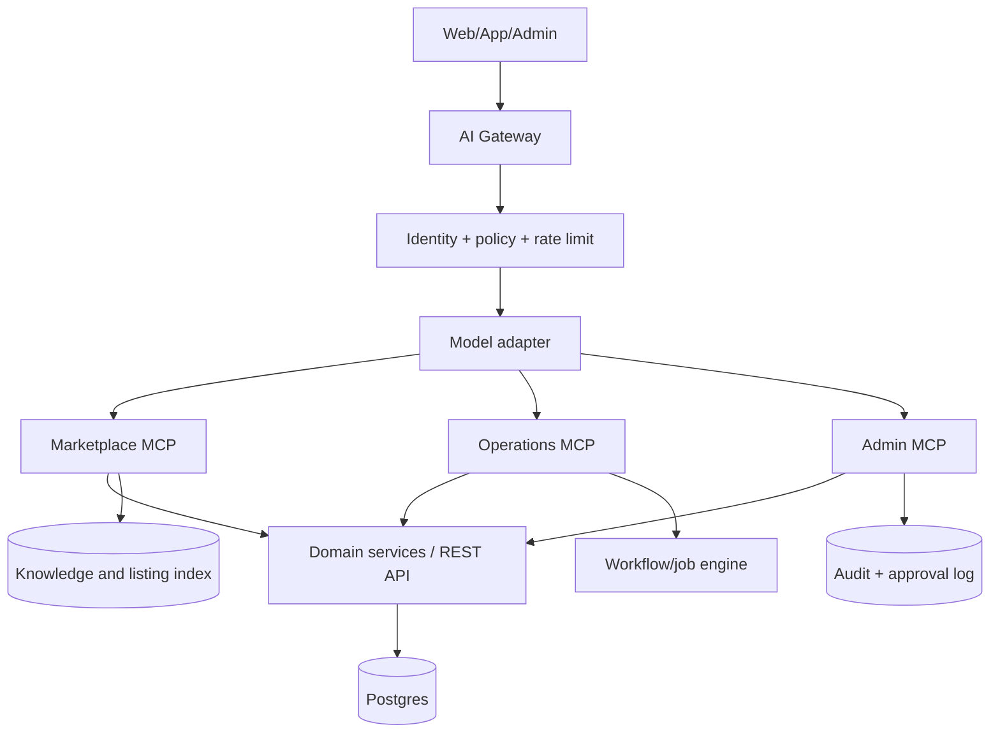

# 03 — Kiến trúc MCP và kết nối AI

## Mục tiêu

MCP là lớp giao tiếp để AI khám phá và dùng dữ liệu/công cụ của Ancu365 theo schema rõ ràng. Lớp này không thay thế API nghiệp vụ, không đưa toàn bộ database vào prompt và không cấp cho model quyền tùy ý.

MCP server phải đứng sau AI gateway, nhận identity, organization, workspace, scope, locale và trace id. Mọi tool write đều gọi service nghiệp vụ hiện có để giữ validation, idempotency, authorization và audit.

MCP hiện mô tả ba nhóm chính: **resources** cung cấp context có cấu trúc, **tools** thực hiện thao tác, **prompts** là template tương tác có thể tái sử dụng. Tham chiếu: [MCP official specification](https://modelcontextprotocol.io/specification/draft/server/index).

## Kiến trúc đề xuất



## Các MCP server

### `ancu365-marketplace`

Resources: listing, room, station, route, amenity, price breakdown, public guide. Tools: search, compare, calculate initial cost, find near station, create viewing request và hỏi availability.

### `ancu365-property-ops`

Resources: tenant case, viewing, application, contract summary, invoice, maintenance ticket và timeline trong scope. Tools: tạo checklist, tóm tắt case, đề xuất slot, tạo task, draft message và tạo maintenance ticket.

### `ancu365-admin`

Resources: policy version, role/capability, moderation queue, automation run, AI evaluation, audit summary. Tools: assign queue, request approval, publish content, pause automation và export report. Các tool nguy hiểm phải yêu cầu approval token.

## Catalog tool đề xuất

| Tool | Đọc/ghi | Role | Approval |
|---|---|---|---|
| `search_listings` | Đọc | Tất cả theo scope | Không |
| `compare_listings` | Đọc | Tenant, sale | Không |
| `calculate_initial_cost` | Đọc | Tenant, sale, owner | Không; đánh dấu ước tính |
| `find_near_station` | Đọc | Tất cả | Không |
| `create_viewing_request` | Ghi | Tenant, sale | Xác nhận người dùng trước khi gửi |
| `draft_bilingual_message` | Đọc/soạn | Sale, owner, admin | Có trước khi gửi |
| `extract_application_document` | Đọc private file | Sale/admin theo scope | Không; kết quả cần review |
| `create_application_checklist` | Ghi task | Sale/admin | Có nếu gửi cho khách |
| `create_maintenance_ticket` | Ghi | Tenant, owner, admin | Xác nhận nếu có chi phí |
| `generate_owner_report` | Đọc | Owner/admin | Không |
| `publish_listing` | Ghi | Sale/owner | Bắt buộc người có quyền duyệt |
| `approve_application` | Ghi tác động cao | Đơn vị có thẩm quyền | Bắt buộc, MFA nếu cần |
| `send_payment_request` | Ghi tác động tiền | Owner/admin | Bắt buộc |

## Resource contract

Mỗi resource trả:

```json
{
  "resource_type": "listing",
  "resource_id": "jp_12345",
  "locale": "ja-JP",
  "version": "2026-10-14T08:30:00Z",
  "fresh_until": "2026-10-14T09:00:00Z",
  "scope": {"organization_id": "org_1", "workspace": "sale"},
  "data": {},
  "source_refs": [{"type": "api", "path": "/api/houses/123"}]
}
```

Resource private không được trả số điện thoại/email đầy đủ nếu caller chưa có capability. Tài liệu upload trả metadata và signed URL có thời hạn, không đẩy file thô vào context nếu chỉ cần trích xuất một trường.

## AI gateway

Gateway đảm nhiệm:

- chọn model theo tác vụ và độ nhạy dữ liệu;
- prompt template có version;
- RAG/reranking và trích nguồn;
- schema validation cho tool arguments và model output;
- PII redaction trước khi gửi model;
- token/cost budget, timeout, retry và circuit breaker;
- lưu input/output hash, tool calls, source refs và human decision;
- chặn prompt injection trong listing, file, tin nhắn và knowledge base.

Không dùng dữ liệu cá nhân hoặc tài liệu hợp đồng để huấn luyện model mặc định. Có thể dùng model cloud, model self-hosted hoặc nhà cung cấp tương thích OpenAI API; adapter phải tách khỏi domain service để đổi nhà cung cấp không làm đổi sản phẩm.

## Prompt và guardrail

Prompt template cần có:

- `tenant_search_jp`: tìm căn theo yêu cầu tự nhiên;
- `sale_follow_up_jp`: đề xuất follow-up sau viewing;
- `owner_weekly_report_jp`: báo cáo occupancy, lead, task, rủi ro;
- `document_review_jp`: liệt kê trường đã đọc và trường thiếu;
- `support_triage_jp`: phân loại support và SLA;
- `admin_audit_summary`: tóm tắt hoạt động bất thường.

System rule: trả lời bằng dữ liệu có nguồn, nêu rõ phần thiếu, không tự bịa availability/phí/pháp lý, không suy đoán quốc tịch hay khả năng được duyệt, chuyển người thật khi confidence thấp.

## Approval model

Tool call write tạo `proposed_action` trước. Người có quyền xem diff, nguồn, lý do, preview tin nhắn và phạm vi tác động rồi `approve`, `reject` hoặc `edit`. Chỉ service backend mới được commit side effect; MCP không ghi trực tiếp database.

## Quan sát và đánh giá

Theo dõi:

- grounded answer rate và citation click rate;
- tool success/error/timeout;
- human correction và override rate;
- P95 latency, token/cost theo workflow;
- số lần model gọi nhầm tool hoặc vượt scope;
- tỷ lệ automation hoàn tất và rollback.

Mỗi thay đổi prompt/model phải chạy bộ eval tiếng Nhật với listing giả lập, hồ sơ thiếu, prompt injection, phí không đầy đủ, người dùng nhiều role và dữ liệu hết hạn.
