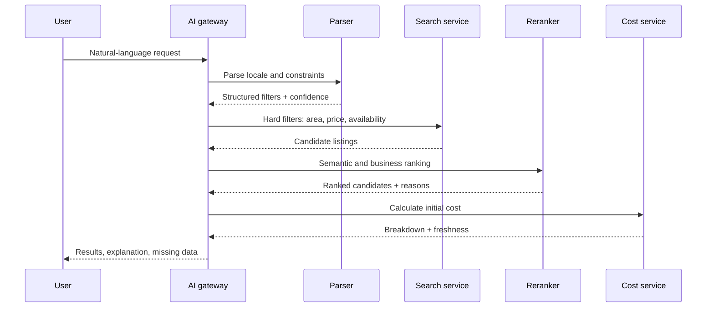

# 05 — Tìm kiếm sản phẩm bằng AI

## Trải nghiệm người dùng

Người dùng có thể gõ hoặc nói nhu cầu bằng tiếng Nhật, Việt hoặc Anh:

> `新宿まで30分以内、家賃8万円以下、1K、駅徒歩10分以内、外国人相談可、敷金礼金ゼロ`

AI hiển thị phần đã hiểu dưới dạng chip có thể sửa:

```text
Khu vực: trong 30 phút tới Shinjuku
Giá thuê: ≤ ¥80,000/tháng
Layout: 1K
Ga: đi bộ ≤ 10 phút
Điều kiện: 外国人相談可, 敷金ゼロ, 礼金ゼロ
```

Người dùng có thể bấm chip để sửa và xem “vì sao căn này được đề xuất”.

## Pipeline tìm kiếm



## Parser output

```json
{
  "locale": "ja-JP",
  "destination": {"name": "新宿", "max_commute_minutes": 30},
  "rent": {"max_jpy": 80000, "include_management_fee": true},
  "layout": ["1K"],
  "station": {"max_walk_minutes": 10},
  "conditions": ["foreign_resident_consultation", "deposit_zero", "key_money_zero"],
  "unknowns": [],
  "confidence": 0.94
}
```

Hard filters xử lý các điều kiện không được vi phạm. Semantic search và reranking chỉ dùng để sắp xếp theo sở thích như yên tĩnh, sáng, phù hợp làm việc tại nhà. Nếu không có dữ liệu commute thật, hệ thống phải nói đó là ước tính hoặc bỏ điều kiện.

## Xếp hạng

Điểm xếp hạng có thể gồm:

- khớp hard filter: bắt buộc;
- khoảng cách/thời gian đến ga hoặc điểm đến;
- tổng chi phí ban đầu và độ đầy đủ của breakdown;
- freshness của availability và giá;
- chất lượng dữ liệu listing;
- sở thích người dùng, nếu đã consent;
- mức độ phù hợp ngữ nghĩa của mô tả.

Không xếp hạng theo quốc tịch, giới tính, tuổi, tình trạng hôn nhân hoặc thuộc tính nhạy cảm. Điều kiện `外国人可` được lấy từ policy listing và hiển thị đúng nguồn, không dùng model đoán.

## Câu trả lời kết quả

Mỗi kết quả AI cần có:

- tên/khu vực/ga;
- giá thuê và phí;
- tổng chi phí ban đầu: đã tính những gì, thiếu gì;
- lý do khớp yêu cầu;
- điều kiện cần xác nhận;
- thời điểm availability/giá được cập nhật;
- nút `内見を予約`, `担当者に相談`, `比較に追加`.

Ví dụ thông báo trung thực:

> Căn này khớp 5/6 điều kiện. Giá và ga đã được xác nhận lúc 10:20 JST. Thông tin `外国人相談可` đang chờ chủ nhà xác nhận, vì vậy chưa coi là chắc chắn.

## RAG và knowledge base

Nguồn index gồm:

- listing field có cấu trúc và lịch sử freshness;
- tài liệu public đã duyệt;
- hướng dẫn thao tác nội bộ;
- policy theo owner/management company;
- FAQ tiếng Nhật và bản dịch đã review;
- tài liệu hợp đồng chỉ index metadata hoặc chunk được cấp quyền.

Mỗi chunk có `source_id`, `tenant_scope`, `locale`, `valid_from`, `valid_until`, `document_version` và `sensitivity`. Chunk hết hạn bị loại hoặc gắn cảnh báo.

## Xử lý thiếu và mâu thuẫn dữ liệu

- thiếu giá: hiển thị `要確認`, không bịa;
- giá trong title khác field: flag content quality;
- listing đã hết phòng: không trả vào kết quả active;
- policy owner thay đổi: lấy version mới nhất và ghi nguồn;
- query quá rộng: hỏi tối đa hai câu làm rõ hoặc trả kết quả theo nhóm;
- không có kết quả: nới một điều kiện mỗi lần và cho người dùng chọn.

## Đánh giá chất lượng

Bộ test phải có query tiếng Nhật tự nhiên, từ viết tắt, kana/kanji, lỗi chính tả, trộn Việt–Nhật, số tiền, `徒歩`, ga, điều kiện người nước ngoài và câu hỏi chi phí. Đo:

- constraint satisfaction rate;
- top-3/top-10 relevance;
- freshness accuracy;
- initial-cost completeness;
- citation correctness;
- tỷ lệ phải chuyển chuyên viên;
- latency và cost.
