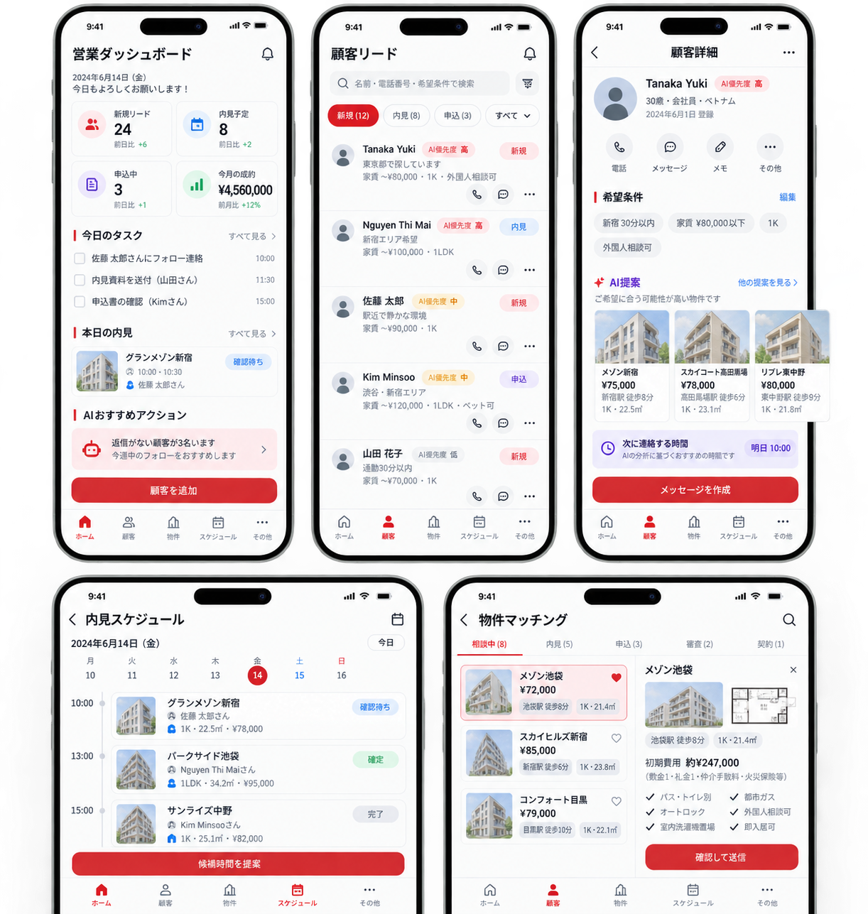
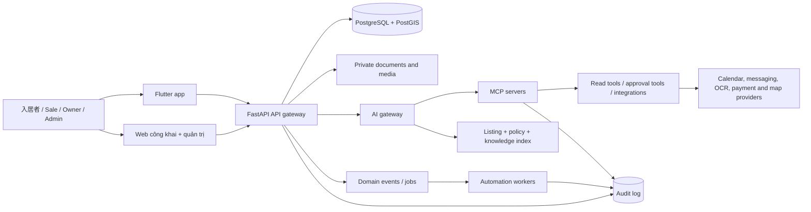
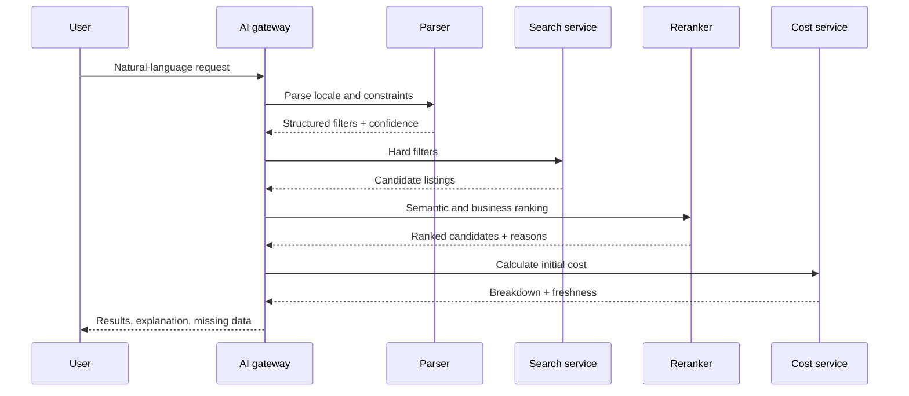

# Ancu365 Japan — hồ sơ giới thiệu và đặc tả hệ thống

> Phiên bản tài liệu: 1.0  
> Phạm vi: web, app, backoffice, AI, MCP, tự động hóa và tìm kiếm bất động sản tại Nhật Bản  
> Trạng thái: đặc tả sản phẩm và kiến trúc mục tiêu

## 1. Tổng quan

Ancu365 Japan là nền tảng hợp nhất hành trình:

```text
Tìm căn phù hợp
→ hỏi thông tin
→ so sánh
→ đặt lịch xem
→ nộp hồ sơ
→ kiểm tra hồ sơ
→ 重要事項説明 / IT重説
→ ký hợp đồng
→ thanh toán
→ chuyển vào ở
→ hỗ trợ và quản lý sau thuê
```

Hệ thống phục vụ bốn nhóm người dùng:

| Vai trò | Tên tiếng Nhật | Mục tiêu |
|---|---|---|
| Khách thuê | 入居者・借主 | Tìm nhà, xem nhà, nộp hồ sơ, theo dõi hợp đồng và yêu cầu hỗ trợ |
| Sale/môi giới | 仲介担当者・営業担当 | Quản lý lead, nguồn hàng, lịch xem, hồ sơ và follow-up |
| Chủ nhà | オーナー・貸主 | Quản lý tòa nhà, phòng, người thuê, listing, tiền và bảo trì |
| Quản trị | 管理者・運営スタッフ | Quản trị người dùng, policy, nội dung, approval, audit và AI |

Một tài khoản có thể được cấp cả ba workspace `入居者`, `仲介担当者`, `オーナー`. Khi đăng nhập, người dùng chọn role muốn làm việc. App chỉ hiển thị menu tương ứng capability do server trả về; client không được tự suy diễn quyền từ role hiển thị.

### 1.1. Phần nào đã có thật và phần nào là mục tiêu

Tài liệu này được xây trên source hiện tại của Vua Nhà, nhưng không phải mọi nội dung trong đây đã được triển khai. Phân chia chính xác như sau:

| Phạm vi | Trạng thái hiện tại |
|---|---|
| Đăng nhập chọn role Khách/Sale/Chủ nhà/Admin | **Đã có trong app**; có `LoginAccountType`, role picker và kiểm tra account type khi đăng nhập |
| Workspace Khách, Sale, Chủ nhà | **Đã có**; app có màn quản lý theo vai trò và typed API cho viewing/stay/short-stay/sale CRM |
| Listing, tìm kiếm, bộ lọc, yêu thích, bản đồ | **Đã có**, hiện dữ liệu và nội dung đang theo thị trường Việt Nam |
| Lịch xem, kết quả sau xem, hành trình thuê | **Đã có một phần lớn** ở backend và app, gồm trạng thái, timeline, quyền xem và deep-link |
| Hợp đồng, hóa đơn, tiền thuê, phòng, tòa nhà, lưu trú ngắn hạn | **Đã có** ở các module hiện tại |
| Sale CRM, lead, task, pipeline, owner operations | **Đã có** ở mức nghiệp vụ hiện tại |
| Admin backoffice, approval, RBAC, private documents, audit | **Đã có** ở backend/web quản trị |
| Nhật hóa locale, JPY, ga/tuyến Nhật, `敷金`/`礼金`, nội dung `ja-JP` | **Chưa triển khai**, đang là phạm vi mục tiêu |
| AI provider, AI gateway, RAG, vector index, AI copilot | **Chưa có kết nối runtime trong app/repo hiện tại** |
| MCP server/resources/tools/prompts | **Chưa có runtime**, mới là phương án kiến trúc trong tài liệu này |
| AI search sản phẩm, OCR hồ sơ, AI automation | **Chưa có runtime**; đã mô tả pipeline, schema, guardrail và roadmap để triển khai |

Nói cách khác, phần nghiệp vụ cốt lõi trong tài liệu dựa trên những gì app Vua Nhà và backend đang có. Phần Nhật hóa và AI được viết như phương án mở rộng có thể gắn lên các module đó; không nên giới thiệu với đối tác rằng MCP, AI search, OCR hoặc automation AI đã chạy production.

### 1.2. Nền tảng hiện tại có thể tái sử dụng cho AI

Các phần hiện có tạo nền móng tốt cho tích hợp AI:

- API listing và search để làm lớp hard filter;
- viewing appointment, rental journey, contract, invoice và short-stay có trạng thái/timeline;
- sale CRM có contact, task, note, pipeline và assignment;
- admin work-items, approval/maker-checker, RBAC, audit và private document controls;
- app có role context/capability và các typed service để thêm AI session/proposal sau này;
- kế hoạch localization đã có hướng `ja-JP` và cơ chế quản lý chuỗi dịch.

Phần còn thiếu để AI chạy thật là model/provider adapter, AI gateway, kho knowledge/vector, ingestion và freshness, MCP server, tool authorization, proposal/approval UI, eval tiếng Nhật, cost/latency monitoring và quy trình vận hành incident.

## 2. Định hướng Nhật hóa

### 2.1. Ngôn ngữ và định dạng

- Ngôn ngữ mặc định: `ja-JP`.
- Ngôn ngữ hỗ trợ: `en-US`, `vi-VN`.
- Tiền tệ: JPY, hiển thị bằng `¥`.
- Múi giờ nghiệp vụ: `Asia/Tokyo`.
- Diện tích: `m²`, có thể hiển thị thêm `畳`.
- Khoảng cách: `徒歩 X 分`.
- Địa chỉ: 都道府県 → 市区町村 → 町名 → 番地.
- Ngày giờ: `YYYY年M月D日`, định dạng 24 giờ.
- Font: Noto Sans JP hoặc font hỗ trợ kana/kanji tương đương.

### 2.2. Thuật ngữ cốt lõi

| Tiếng Nhật | Ý nghĩa |
|---|---|
| 物件 | Bất động sản/listing |
| 部屋 | Phòng/căn cụ thể |
| 最寄り駅 | Ga gần nhất |
| 賃料 | Tiền thuê cơ bản |
| 管理費 / 共益費 | Phí quản lý/phí sử dụng chung |
| 敷金 | Tiền đặt cọc theo hợp đồng |
| 礼金 | Tiền lễ/key money |
| 仲介手数料 | Phí môi giới |
| 保証会社 | Công ty bảo lãnh |
| 連帯保証人 | Người bảo lãnh liên đới |
| 更新料 | Phí gia hạn |
| 内見 | Xem nhà |
| 申込 | Hồ sơ đăng ký thuê |
| 審査 | Kiểm tra hồ sơ |
| 重要事項説明 | Giải thích các điều quan trọng |
| IT重説 | Giải thích qua phương tiện IT |
| 入居 | Chuyển vào ở |

### 2.3. Bộ tiêu chí tìm nhà

Người dùng có thể lọc theo:

- 都道府県, 市区町村, khu vực, mã bưu chính;
- ga gần nhất, tuyến, số phút đi bộ;
- giá thuê, phí quản lý, tổng chi phí hàng tháng;
- tổng chi phí ban đầu;
- layout `1R`, `1K`, `1DK`, `1LDK`, `2LDK`;
- diện tích, tầng, hướng, năm xây dựng;
- `敷金ゼロ`, `礼金ゼロ`, `保証人不要`, `外国人相談可`, `ペット可`, `楽器可`, `事務所利用可`, `即入居可`;
- `バス・トイレ別`, `独立洗面台`, `宅配ボックス`, `オートロック`, `エレベーター`, `エアコン`, `家具・家電付き`;
- thuê dài hạn, thuê monthly, share house, corporate lease, ngày dự kiến chuyển vào.

Nhãn như `外国人可` phải lấy từ policy được chủ nhà hoặc công ty quản lý xác nhận. Hệ thống không được tự suy ra điều kiện này từ quốc tịch, tên hoặc ngôn ngữ của người dùng.

### 2.4. Minh bạch chi phí

Trang listing cần tính và giải thích:

```text
Tổng tháng đầu = 賃料 + 管理費/共益費 + 日割り家賃 + 敷金 + 礼金
              + 仲介手数料 + 保証会社初回料 + bảo hiểm + phí chìa khóa
              + các khoản bắt buộc khác theo listing
```

Mỗi khoản cần có số tiền, tiền tệ, đã bao gồm thuế hay chưa, bắt buộc hay tùy chọn, một lần hay định kỳ, nguồn dữ liệu và thời gian hiệu lực. Nếu còn thiếu khoản, hệ thống phải hiển thị `要確認` hoặc “cần xác nhận”, không được tự bịa tổng tiền.

## 3. Các bề mặt sản phẩm

### 3.1. Web công khai

Web dùng Next.js SEO/SSR để người dùng có thể tìm thấy sản phẩm qua Google và chia sẻ trực tiếp listing.

Trang chủ đề xuất:

> **日本で、あなたに合う住まいを探す**  
> Ga, ngân sách, điều kiện sống và tổng chi phí được giải thích rõ ràng.

CTA chính:

- `物件を探す` — tìm bất động sản;
- `条件を入力してAIで探す` — tìm bằng AI;
- `初期費用を計算` — tính chi phí ban đầu;
- `外国人向けの部屋探しガイド` — hướng dẫn người nước ngoài thuê nhà.

Web gồm:

- trang tìm kiếm theo ga, tuyến, khu vực và ngân sách;
- trang chi tiết listing;
- so sánh nhiều căn;
- tính tổng chi phí ban đầu;
- đặt lịch xem;
- form nhận lead;
- bài hướng dẫn `部屋探し`, `内見`, `申込`, `審査`, `契約`, `引越し`;
- landing SEO như `外国人相談可 東京 賃貸`, `敷金礼金ゼロ 大阪`, `家具家電付き マンスリー`.

Mỗi trang SEO phải liên kết đến listing thật, hiển thị ngày cập nhật, bộ lọc đang dùng và trạng thái dữ liệu. Không tạo hàng loạt trang AI rỗng hoặc dùng nội dung AI chưa được duyệt như cam kết pháp lý.

### 3.2. App Flutter

App vẫn giữ nền tảng đa vai trò hiện tại nhưng nội dung và dữ liệu được chuyển sang trải nghiệm Nhật.

#### Luồng đăng nhập

1. Chọn ngôn ngữ.
2. Chọn `入居者`, `仲介担当者`, `オーナー` hoặc `管理者` nếu tài khoản có quyền.
3. Đăng nhập bằng email/số điện thoại và mật khẩu; có thể mở rộng OTP.
4. Server trả về capability và workspace được cấp.
5. App mở dashboard theo role.
6. Người dùng có thể đổi role trong profile nếu tài khoản có nhiều role.

#### Workspace 入居者・借主

- `探す`: tìm nhà, AI search, map/ga, bộ lọc;
- `お気に入り`: lưu và so sánh;
- `内見`: đề xuất slot, xác nhận, đổi lịch và nhắc lịch;
- `申込`: checklist hồ sơ, OCR, trạng thái và tài liệu thiếu;
- `契約・支払い`: tài liệu, khoản phải trả và lịch hạn;
- `入居中`: yêu cầu sửa chữa, meter và thông báo;
- `サポート`: chat, AI FAQ và chuyển người thật.

#### Workspace 仲介担当者

- lead từ web/app và phân loại tự động;
- nguồn hàng và availability;
- matching khách với listing;
- lịch xem và kết quả sau xem;
- pipeline `新規 → 相談中 → 内見 → 申込 → 審査 → 契約 → 成約`;
- soạn tin nhắn Nhật/Anh/Việt;
- AI copilot tóm tắt timeline và đề xuất việc tiếp theo.

#### Workspace オーナー・貸主

- dashboard tòa/phòng và tỷ lệ trống;
- listing và điều kiện thuê;
- policy `外国人相談可`, `ペット可`;
- duyệt lịch xem, hồ sơ và tài liệu;
- hợp đồng, tiền thuê, hóa đơn và bảo trì;
- báo cáo tuần/tháng bằng tiếng Nhật;
- phê duyệt hành động AI đề xuất.

#### Workspace 管理者・運営スタッフ

- hàng đợi hồ sơ và nội dung cần duyệt;
- quản lý user, role, organization và policy;
- AI/MCP run history, approval queue, error và cost;
- audit log, data export, retention và incident;
- catalog thuật ngữ, bản dịch, template và knowledge base.

### 3.3. Giao diện

Giữ design token và component library hiện tại, nhưng thay nội dung và trạng thái theo Nhật:

- nền trung tính, card rõ ràng, accent tin cậy;
- mobile first và responsive;
- loading, empty, error, stale-data state đầy đủ;
- nút tác động cao như `契約を承認`, `支払いを実行`, `申込を送信` phải cho biết người duyệt và tác động;
- lỗi phải nói rõ người dùng cần làm gì tiếp theo.

Các trạng thái quan trọng:

| Trạng thái | Hiển thị |
|---|---|
| Listing cũ | `情報を更新中` |
| Thiếu dữ liệu giá | `初期費用は要確認` |
| AI chưa chắc chắn | `担当者の確認が必要です` |
| Hồ sơ thiếu file | `不足書類があります` |
| Chờ duyệt | `確認待ち` |
| Không có kết quả | `条件に合う物件が見つかりません` |

### 3.4. Mockup các màn Sale

Mockup v1 gồm năm màn mobile theo cùng một design system:

1. `営業ダッシュボード` — KPI, task hôm nay, lịch xem và AI recommended actions.
2. `顧客リード` — danh sách lead, filter theo trạng thái và badge AI priority.
3. `顧客詳細` — nhu cầu khách, các căn AI đề xuất và draft hành động tiếp theo.
4. `内見スケジュール` — lịch xem theo ngày, trạng thái xác nhận và đề xuất slot.
5. `物件マッチング` — danh sách căn phù hợp, chi phí ban đầu và pipeline `相談中 → 内見 → 申込 → 審査 → 契約`.



Đây là hình định hướng UX, chưa phải ảnh chụp từ source code production. Các label và số liệu trong mockup là dữ liệu minh họa.

## 4. Kiến trúc hệ thống



Nền tảng hiện tại đã có các thành phần có thể tái sử dụng: FastAPI, PostgreSQL/PostGIS, JWT, REST/WebSocket, listing, viewing appointment, rental journey, contract, tenant, invoice, sale CRM, owner workspace và admin backoffice. Phần Nhật hóa nên triển khai bằng API additive và feature flag để không làm đứt luồng cũ.

## 5. MCP và kết nối AI

MCP là lớp cho phép AI khám phá và sử dụng dữ liệu/công cụ của Ancu365 theo schema rõ ràng. MCP không thay thế API nghiệp vụ, không đưa toàn bộ database vào prompt và không cấp quyền tùy ý cho model.

MCP dùng ba nhóm chính:

- **Resources:** dữ liệu hoặc context có cấu trúc;
- **Tools:** thao tác đọc/ghi có schema;
- **Prompts:** template tương tác có thể tái sử dụng.

### 5.1. Các MCP server

#### `ancu365-marketplace`

Resources listing, room, station, route, amenity, price breakdown và public guide. Tools tìm kiếm, so sánh căn, tính chi phí, tìm gần ga, hỏi availability và tạo yêu cầu xem.

#### `ancu365-property-ops`

Resources tenant case, viewing, application, contract summary, invoice, maintenance ticket và timeline theo scope. Tools tạo checklist, tóm tắt case, đề xuất lịch, tạo task, draft message và maintenance ticket.

#### `ancu365-admin`

Resources policy version, role/capability, moderation queue, automation run, AI evaluation và audit summary. Tools assign queue, request approval, publish content, pause automation và generate report.

### 5.2. Tool catalog

| Tool | Loại | Role | Approval |
|---|---|---|---|
| `search_listings` | Đọc | Tất cả theo scope | Không |
| `compare_listings` | Đọc | Tenant, sale | Không |
| `calculate_initial_cost` | Đọc | Tenant, sale, owner | Không; đánh dấu ước tính |
| `find_near_station` | Đọc | Tất cả | Không |
| `create_viewing_request` | Ghi | Tenant, sale | Xác nhận trước khi gửi |
| `draft_bilingual_message` | Soạn | Sale, owner, admin | Duyệt trước khi gửi |
| `extract_application_document` | Đọc private file | Sale/admin theo scope | Cần review kết quả |
| `create_application_checklist` | Tạo task | Sale/admin | Duyệt nếu gửi cho khách |
| `create_maintenance_ticket` | Ghi | Tenant, owner, admin | Xác nhận nếu có chi phí |
| `generate_owner_report` | Đọc | Owner/admin | Không |
| `publish_listing` | Ghi | Sale/owner | Người có quyền duyệt |
| `approve_application` | Tác động cao | Người có thẩm quyền | Bắt buộc |
| `send_payment_request` | Tác động tiền | Owner/admin | Bắt buộc |

### 5.3. AI gateway

AI gateway đảm nhiệm:

- chọn model theo tác vụ và độ nhạy dữ liệu;
- prompt template có version;
- RAG, reranking và trích nguồn;
- schema validation cho tool arguments và output;
- mask PII trước khi gửi model;
- token/cost budget, timeout, retry và circuit breaker;
- ghi lại source refs, tool calls và human decision;
- chặn prompt injection trong listing, file, tin nhắn và knowledge base.

AI không được tự bịa availability, phí, quy định, khả năng được duyệt hoặc điều kiện thuê. Khi confidence thấp, hệ thống phải chuyển cho chuyên viên.

### 5.4. Approval model

Tool ghi không commit thẳng vào database. Nó tạo `proposed_action` gồm preview, nguồn, lý do, scope, risk và expiry. Người có quyền xem diff rồi `approve`, `reject` hoặc `edit`. Domain service backend mới thực hiện side effect.

Chuỗi audit cần truy ngược được:

```text
user_request
→ prompt_version
→ model
→ retrieved_sources
→ tool_calls
→ proposed_action
→ approval
→ domain_event
→ final_state
```

## 6. Tìm kiếm bất động sản bằng AI

Người dùng có thể nhập bằng tiếng Nhật, Việt hoặc Anh:

> `新宿まで30分以内、家賃8万円以下、1K、駅徒歩10分以内、外国人相談可、敷金礼金ゼロ`

AI phải trả lại các chip có thể sửa:

```text
Điểm đến: Shinjuku
Thời gian di chuyển: tối đa 30 phút
Giá thuê: tối đa ¥80,000/tháng
Layout: 1K
Ga: đi bộ tối đa 10 phút
Điều kiện: 外国人相談可, 敷金ゼロ, 礼金ゼロ
```

### 6.1. Pipeline



### 6.2. Parser output mẫu

```json
{
  "locale": "ja-JP",
  "destination": {"name": "新宿", "max_commute_minutes": 30},
  "rent": {"max_jpy": 80000, "include_management_fee": true},
  "layout": ["1K"],
  "station": {"max_walk_minutes": 10},
  "conditions": ["foreign_resident_consultation", "deposit_zero", "key_money_zero"],
  "unknowns": [],
  "confidence": 0.94
}
```

Hard filter xử lý điều kiện bắt buộc. Semantic search và reranking chỉ sắp xếp các sở thích như yên tĩnh, sáng hoặc phù hợp làm việc tại nhà. Không xếp hạng theo quốc tịch, giới tính, tuổi, hôn nhân hoặc thuộc tính nhạy cảm.

Mỗi kết quả phải hiển thị:

- tên, khu vực và ga;
- giá thuê và phí;
- tổng chi phí ban đầu và các khoản còn thiếu;
- lý do khớp yêu cầu;
- điều kiện cần xác nhận;
- thời gian cập nhật availability/giá;
- nút `内見を予約`, `担当者に相談`, `比較に追加`.

## 7. Tự động hóa quy trình

### 7.1. Lead và follow-up

Khi có lead từ web/app:

1. Chuẩn hóa email/số điện thoại và phát hiện lead trùng.
2. Tách nhu cầu thành khu vực, ga, ngân sách, layout, ngày vào và điều kiện.
3. AI gắn nhãn với confidence.
4. Matching với listing phù hợp.
5. Gán sale theo khu vực, ngôn ngữ và tải công việc.
6. Tạo task phản hồi trong SLA.
7. Tạo draft tiếng Nhật để sale duyệt.

AI được tự động phân loại và tạo task. Tin nhắn ra ngoài, cam kết giá/availability hoặc từ chối lead phải có người duyệt.

### 7.2. Lịch xem

- đọc availability của sale/owner và căn;
- đề xuất ba slot;
- giữ slot tạm thời có TTL;
- gửi xác nhận sau khi người dùng đồng ý;
- nhắc trước 24 giờ và 2 giờ;
- sau lịch, tạo task ghi kết quả;
- nếu no-show, đề xuất đổi lịch.

### 7.3. Hồ sơ thuê và OCR

- chọn checklist theo listing, tenant type và policy;
- OCR file private;
- trả confidence, source page và trường đã đọc;
- báo tài liệu thiếu, sai định dạng hoặc sắp hết hạn;
- tạo task cho sale/admin review;
- chuyển sang `確認待ち` khi đủ hồ sơ.

AI không dùng để tự quyết định duyệt hồ sơ. File gốc nằm trong private storage; model chỉ nhận bản mask hoặc phần cần đọc.

### 7.4. IT重説 và hợp đồng

Automation có thể chuẩn bị checklist, version tài liệu, lịch, reminder, link phiên, trạng thái đã mở tài liệu và bản preview. Việc giải thích, ký, sửa hợp đồng và xác nhận pháp lý vẫn theo quy trình của đơn vị môi giới và người có thẩm quyền.

### 7.5. Hóa đơn và gia hạn

- tạo invoice theo kỳ;
- nhắc trước hạn;
- phát hiện quá hạn;
- nhắc gia hạn trước 90/60/30 ngày;
- tạo checklist trả phòng hoặc gia hạn;
- tóm tắt hợp đồng, phí và việc cần làm.

Không tự thay đổi số tiền, gia hạn hoặc gửi yêu cầu thanh toán khi chưa có approval.

### 7.6. Bảo trì

AI phân loại sự cố, địa điểm, thiết bị, mức độ và ngôn ngữ; sau đó tạo ticket, gán vendor và SLA. Sự cố nguy hiểm phải báo người trực. Chi phí phát sinh cần owner/admin duyệt.

### 7.7. Báo cáo chủ nhà

Hàng tuần, AI tạo bản nháp tiếng Nhật gồm phòng trống, lead, viewing, application, doanh thu dự kiến, invoice cần chú ý, ticket quá SLA và đề xuất tuần sau. Owner xem nguồn rồi bấm `承認して共有`.

### 7.8. Moderation listing

AI phát hiện listing thiếu giá, ảnh, ga, phí, điều kiện hoặc có mâu thuẫn giữa title và field. AI chỉ tạo moderation flag và bản sửa đề xuất; moderator mới quyết định publish, sửa hoặc ẩn.

### 7.9. State machine automation

```text
detected → classified → proposed → awaiting_approval → approved → executed
                                      ↘ rejected
executed → verified → completed
executed → failed → retrying → dead_letter → manual_review
```

Mỗi run có `run_id`, `idempotency_key`, actor, policy version, input snapshot, output, source refs, timestamp và error code.

## 8. Dữ liệu, bảo mật và quản trị AI

### 8.1. Phân loại dữ liệu

| Nhóm | Ví dụ | Quy tắc |
|---|---|---|
| Public | Listing đã publish, ga, tiện ích | Có thể index nếu còn hiệu lực |
| Internal | Ghi chú sale, SLA, owner report | Chỉ workspace được cấp |
| Personal | Tên, email, phone, địa chỉ | Mask, purpose, retention, audit |
| Sensitive document | Hộ chiếu, thẻ cư trú, thu nhập, hợp đồng | Private storage, signed URL, least privilege |
| Secret | JWT secret, provider key, MCP credential | Secret manager, không vào log/prompt |

### 8.2. Quy tắc AI/MCP

- MCP nhận identity từ gateway, không tin `user_id` model tự tạo.
- Mọi resource/tool kiểm tra organization, workspace và object ownership.
- Tool write có allowlist, schema validation, idempotency và approval.
- Không cho model đọc secret, raw database hoặc tài liệu ngoài scope.
- Mask phone, email, số ID và địa chỉ đầy đủ nếu model không cần.
- Không ghi nguyên văn PII vào log.
- Có timeout, rate limit, budget, circuit breaker và kill switch.
- Kiểm tra nơi xử lý dữ liệu, lưu log, việc dùng dữ liệu cho training và chuyển dữ liệu xuyên biên giới của AI provider.

### 8.3. Ma trận capability

| Capability | Customer | Sale | Owner | Admin |
|---|---:|---:|---:|---:|
| Tìm listing public | ✓ | ✓ | ✓ | ✓ |
| Xem lead được gán | — | ✓ | Theo tài sản | Theo scope |
| Xem hồ sơ thuê | Của mình | Được gán | Tài sản của mình | Theo policy |
| Sửa listing | — | Được cấp | Tài sản của mình | ✓ |
| Duyệt hồ sơ | — | Đề xuất | Theo policy | ✓/delegated |
| Gửi payment request | — | — | Đề xuất | Theo policy |
| Quản lý role/policy | — | — | — | ✓ |

### 8.4. Audit

Audit event tối thiểu gồm actor, role, organization, action, object, before/after hash, nguồn thao tác (human/automation/AI/MCP), tool name, approval id, policy version và timestamp.

Các sự kiện phải audit:

- đọc tài liệu nhạy cảm;
- reveal contact;
- AI gọi tool;
- approve/reject/edit đề xuất;
- thay đổi role/capability;
- publish/unpublish listing;
- thay đổi tiền, hợp đồng hoặc trạng thái hồ sơ;
- export/delete dữ liệu.

### 8.5. Incident response

Khi AI/MCP gọi sai hoặc lộ scope:

1. Tắt tool/workflow bằng kill switch.
2. Giữ audit và snapshot liên quan.
3. Kiểm tra token, signed URL và quyền đã dùng.
4. Rollback side effect nếu nghiệp vụ cho phép.
5. Báo owner/admin phụ trách.
6. Đánh giá phạm vi dữ liệu và nghĩa vụ thông báo.
7. Cập nhật policy, test và eval trước khi bật lại.

## 9. API và tích hợp

### 9.1. Nguyên tắc API

- Giữ route hiện tại; field/endpoint Nhật hóa bổ sung theo hướng additive.
- Mọi write command có idempotency key, actor context, policy version và audit.
- Không tin `owner_id`, `sale_id` hoặc `workspace` do client tự gửi.
- Public API không trả contact đầy đủ hoặc tài liệu private.
- API dùng ISO 8601 UTC; UI đổi sang Asia/Tokyo.
- Tiền dùng integer JPY và currency rõ ràng.

### 9.2. Domain API mục tiêu

| Domain | Endpoint gợi ý | Mục đích |
|---|---|---|
| Auth/workspace | `/api/auth/login`, `/api/auth/me`, `/api/workspaces` | Đăng nhập, capability, role context |
| Catalog | `/api/catalog/jp`, `/api/i18n`, `/api/policies` | Ga, tuyến, layout, label, policy |
| Search | `/api/jp/listings`, `/api/jp/search/interpret`, `/api/jp/search/explain` | Search có cấu trúc và AI |
| Cost | `/api/jp/listings/{id}/initial-cost` | Chi phí đầu vào |
| Viewing | `/api/viewing-appointments`, `/api/viewing-appointments/{id}/slots` | Lịch xem |
| Application | `/api/applications`, `/api/applications/{id}/checklist` | Hồ sơ thuê |
| Contract | `/api/contracts`, `/api/contracts/{id}/explanation-readiness` | Hợp đồng và IT重説 readiness |
| Operations | `/api/work-items`, `/api/maintenance-tickets`, `/api/automation-runs` | Task, support, job |
| AI | `/api/ai/sessions`, `/api/ai/proposals`, `/api/ai/evals` | Session, proposal, eval |
| Admin | `/api/admin/policies`, `/api/admin/approvals`, `/api/admin/audit` | Policy, approval, audit |

Đây là hợp đồng mục tiêu; trước khi code phải map với route hiện tại và không đổi route legacy chỉ để đổi tên.

### 9.3. Listing schema Nhật hóa

```json
{
  "id": 123,
  "locale": "ja-JP",
  "status": "募集中",
  "transaction_type": "rent",
  "property_type": "apartment",
  "layout": "1K",
  "rent": {"amount": 78000, "currency": "JPY", "period": "month"},
  "management_fee": {"amount": 5000, "currency": "JPY"},
  "area_m2": 25.4,
  "stations": [{"name": "池袋", "line": "JR山手線", "walk_minutes": 8}],
  "conditions": {"foreign_resident": "consultation", "pet": false},
  "initial_cost": {"status": "estimated", "total": 247000, "currency": "JPY"},
  "freshness": {"checked_at": "2026-10-14T08:30:00Z", "expires_at": "2026-10-14T09:00:00Z"},
  "source": {"organization_id": "org_1", "verified": false}
}
```

### 9.4. Tích hợp bên ngoài

Có thể tích hợp bản đồ/geocoding, ga/tuyến, calendar, email, SMS, push, chat, OCR, private storage, antivirus, payment provider, chữ ký số và model provider.

Mỗi connector cần interface, health check, timeout, retry, circuit breaker, secret reference, data classification và fallback thủ công. MCP không gọi trực tiếp connector; MCP gọi domain service hoặc connector gateway.

## 10. Roadmap triển khai

### Phase 0 — Nền tảng Nhật hóa

- locale, font, timezone, JPY;
- catalog thuật ngữ và bản dịch;
- ga/tuyến/walking minutes/layout/initial cost;
- privacy notice, retention, audit baseline;
- feature flag cho Japan search và AI.

**Gate:** API cũ không lỗi, không lộ phone/document, listing không có giá mâu thuẫn, locale test pass.

### Phase 1 — Web/app tìm kiếm Nhật

- SEO landing;
- bộ lọc và calculator chi phí;
- role picker và workspace Nhật hóa;
- favorite, compare, viewing;
- hướng dẫn người nước ngoài;
- dashboard freshness và content quality.

### Phase 2 — AI search và copilot read-only

- natural-language parser;
- hybrid search và reranking;
- RAG knowledge hub;
- MCP resources và read-only tools;
- AI summary cho sale, owner, admin.

**Gate:** eval tiếng Nhật, citation correctness và scope isolation pass; chưa bật tool write.

### Phase 3 — Automation có approval

- lead triage;
- lịch xem;
- checklist hồ sơ và OCR;
- draft message đa ngôn ngữ;
- maintenance triage;
- owner report;
- MCP proposal/approval queue.

### Phase 4 — Tích hợp sâu

- calendar/messaging/payment/OCR production;
- IT重説 readiness theo policy đối tác;
- vendor maintenance;
- organization/management company;
- continuous AI eval và cost routing.

### Feature flags

```text
jp_locale_enabled
jp_listing_fields_enabled
jp_ai_search_enabled
mcp_read_enabled
mcp_write_proposals_enabled
automation_lead_triage_enabled
automation_document_ocr_enabled
```

Write/side effect mặc định tắt. Rollout theo `internal → pilot partner → 10% → 50% → 100%`, có dashboard, on-call và rollback bằng flag.

## 11. KPI

| Nhóm | Chỉ số |
|---|---|
| Acquisition | Organic landing to search, signup completion, qualified lead rate |
| Search | Search-to-detail, detail-to-viewing, top-3 relevance, constraint satisfaction |
| Conversion | Viewing attendance, application completion, document completion, contract conversion |
| Operations | Thời gian phản hồi lead, task đúng SLA, no-show, thời gian xử lý bảo trì |
| AI | Grounded answer, citation correctness, human correction, unsafe tool call, cost/session |
| Trust | Stale listing rate, missing-cost rate, complaint rate, audit completeness |
| Business | Active listings, occupancy, owner retention, revenue per organization |

Baseline phải được đo trước rollout; không đặt mục tiêu phần trăm khi chưa có dữ liệu production đủ tin cậy.

## 12. Kịch bản demo 15–20 phút

### Bước 1 — Giới thiệu

> **Ancu365 Japan は、物件探しから入居後の管理までをつなぐ、AI対応の不動産プラットフォームです。**

Giới thiệu ba nhóm chính: 入居者, 仲介担当者 và オーナー/管理会社.

### Bước 2 — Tìm nhà bằng AI

Nhập:

> `新宿まで30分以内、家賃8万円以下、1K、駅徒歩10分以内、外国人相談可、敷金礼金ゼロ`

Cho xem chips, kết quả, lý do khớp, tổng chi phí, freshness và nút đặt lịch. Nêu rõ AI không khẳng định chắc chắn `外国人相談可` nếu owner chưa xác nhận.

### Bước 3 — Role picker trên app

Đăng nhập tài khoản demo nhiều role, lần lượt mở:

- `入居者`: favorite, viewing, checklist;
- `仲介担当者`: lead, lịch xem và follow-up;
- `オーナー`: phòng trống, listing, task.

### Bước 4 — MCP và AI copilot

Hỏi:

> “Tóm tắt các khách đã xem căn này trong tuần, căn nào cần follow-up hôm nay và nguồn dữ liệu là gì?”

Cho xem AI đọc resource đúng scope, gọi read-only tool, trả timeline có source và tạo draft task chưa gửi.

### Bước 5 — Hồ sơ thuê

Dùng tài liệu giả lập để trình diễn OCR, confidence, trường thiếu và checklist song ngữ. Không trình diễn tự duyệt hợp đồng hoặc tự chuyển tiền.

### Bước 6 — Backoffice

Cho xem policy version, automation run, tool call, approval, audit chain, KPI và kill switch.

Thông điệp chốt:

> **探す、比較する、内見する、申込を進める。その後の管理まで、データとAIでつなぎます。**

## 13. Nguồn tham chiếu và giới hạn

Tài liệu này là đặc tả sản phẩm, không thay thế tư vấn pháp lý, giấy phép hoặc quy trình nghiệp vụ của đối tác tại Nhật.

- [国土交通省 — 賃貸住宅標準契約書](https://www.mlit.go.jp/jutakukentiku/house/jutakukentiku_house_tk3_000023.html)
- [国土交通省 — IT重説 Q&A](https://www.mlit.go.jp/common/001224217.pdf)
- [出入国在留管理庁 — 外国人の民間賃貸住宅入居円滑化ガイドライン](https://www.moj.go.jp/isa/content/001347827.pdf)
- [個人情報保護委員会 — APPI guidelines](https://www.ppc.go.jp/personalinfo/legal/guidelines_tsusoku/)
- [Model Context Protocol — official specification](https://modelcontextprotocol.io/specification/draft/server/index)

Các tài liệu nhỏ trong cùng thư mục vẫn được giữ lại để đội kỹ thuật tra cứu theo từng chủ đề. File này là bản đọc liền mạch dành cho chủ sản phẩm, đối tác, sales và người duyệt phạm vi.
